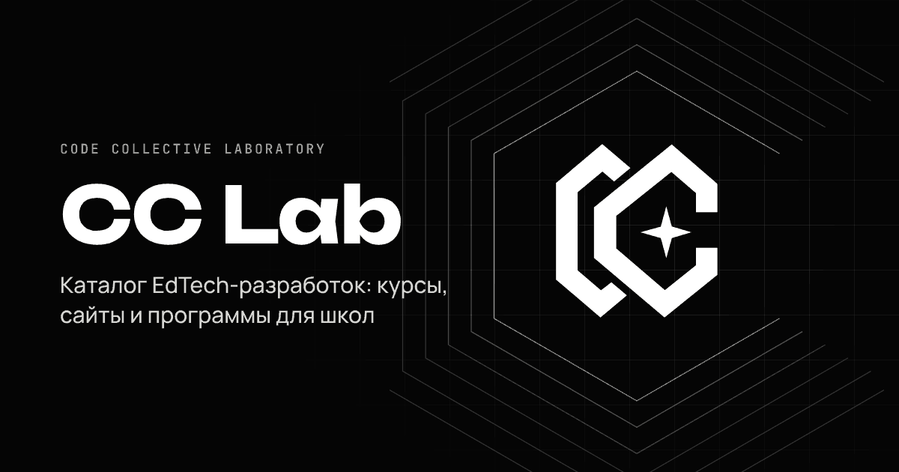

# CC Lab — Code Collective Laboratory

Каталог EdTech-разработок: курсы, сайты для школ, образовательные программы и платформы.
Посетители выбирают разработку и оставляют заявку, а команда управляет всем через админку —
без программиста и без правки кода.



## Что внутри

**Сайт**
- Главная: первый экран с логотипом, направления, избранные разработки, «Как мы работаем со школами», «О лаборатории», форма заявки.
- Каталог с поиском (кириллица, казахские буквы), фильтром по категориям и тегам, сортировкой по цене и новизне.
- Страница разработки: описание, «Что входит», программа по модулям, галерея, цена, ссылка на демо и форма заявки именно на этот продукт.
- Фирменные генеративные обложки в стиле логотипа — если картинку не загрузили, карточка всё равно выглядит аккуратно.
- SEO: `sitemap.xml`, `robots.txt`, Open Graph-превью для мессенджеров и соцсетей, адаптив под телефоны.

**Админка** (`/admin`)
- **Разработки** — создать, отредактировать, опубликовать / снять с публикации, сделать копию, удалить. Черновики видны только админам (можно посмотреть «Предпросмотр»).
- Поля: название, короткое и подробное описание (Markdown), что входит, программа, для кого, длительность, формат, теги, цена (или «по запросу») с уточнением, ссылка на демо, обложка и галерея до 12 картинок, отметка «Хит», порядок.
- **Категории** — свои разделы каталога (по умолчанию: Курсы, Сайты для школ, Образовательные программы, Платформы).
- **Заявки** — все обращения с сайта, статусы (новая / в работе / закрыта / отказ), заметки для команды, выгрузка в CSV (открывается в Excel).
- **Настройки** — тексты главной, контакты, валюта, часовой пояс.
- **Команда** — несколько администраторов, смена пароля.
- Уведомления о новых заявках в Telegram (по желанию).

## Языки и тема

Сайт работает на трёх языках: **русский** (основной, адреса без префикса), **казахский** — `/kk/…`, **английский** — `/en/…`.
Переключатель языка — в шапке и подвале; для поисковиков проставлены `hreflang` и общий `sitemap.xml`.

- Тексты интерфейса (меню, кнопки, блоки главной, форма заявки) лежат в `src/locales/ru.js`, `kk.js`, `en.js`.
- Контент переводится в админке: у разработки — панель **«Переводы»**, у категории — блок **«Переводы»**,
  тексты главной — в **«Настройках»** (группы «Главная — Қазақша / English»). Пустое поле → на сайте показывается русский текст.
- Теги ведутся по-русски и показываются только на русской версии.
- Заявка запоминает язык, на котором её оставили (метка в «Заявках», колонка в CSV и строка в Telegram).

Тема по умолчанию тёмная; кнопка ☀/☾ в шапке включает светлую, выбор запоминается (cookie `cclab_theme`).
Все анимации отключаются, если в системе включено «Уменьшить движение».

## Быстрый старт

Нужен **Node.js 22+** ([скачать](https://nodejs.org)). Отдельную базу ставить не надо: локально сайт использует встроенный Postgres (PGlite) и хранит данные в папке `data/`.

```bash
npm install
cp .env.example .env      # по желанию: задайте ADMIN_EMAIL и ADMIN_PASSWORD
npm start
```

Откройте http://localhost:3000, админка — http://localhost:3000/admin.

При первом запуске создаётся администратор из `ADMIN_EMAIL` / `ADMIN_PASSWORD`.
Если пароль не задан, он генерируется и **печатается в логе сервера** — сохраните его и смените в разделе «Команда».

Каталог сразу заполнен **демо-разработками**, чтобы было видно, как всё выглядит.
Удалите их кнопкой «Удалить демо-данные» на главной странице админки (те, что вы уже отредактировали, останутся).

> `npm start` и Docker Compose автоматически подхватывают файл `.env`.
> Все переменные описаны в [`.env.example`](.env.example).

## Как добавить новую разработку

1. Админка → **Разработки** → **+ Новая разработка**.
2. Заполните название и короткое описание — это то, что видно в карточке каталога.
3. «Что входит» — по одному пункту на строку. «Программа» — по строке на модуль в формате `Название — описание`.
4. Цена — просто число (`150000` или `150 000`). Пустое поле → «По запросу». В «Уточнении» напишите, например, «за школу / год».
5. Загрузите обложку (лучше 16:10, от 1280×800) и, если есть, скриншоты в галерею.
6. Статус «Опубликовано» → **Сохранить**. Разработка сразу появится в каталоге.

Продаёте сайт вместе с программой для школы — заведите его в категории «Сайты для школ»,
в «Что входит» перечислите состав комплекта, а в «Ссылка на демо» дайте адрес демо-версии.

## Деплой

Данные (разработки, заявки, настройки и загруженные картинки) хранятся в базе PostgreSQL.

- Если задана переменная `DATABASE_URL` — используется она (например, бесплатная база [Supabase](https://supabase.com)).
- Если нет — встроенный PGlite в папке `DATA_DIR` (по умолчанию `./data`), это удобно для своего компьютера или VPS.

**Vercel + Supabase** (бесплатно, без своего сервера):

1. Создайте проект в Supabase и скопируйте строку подключения *Transaction pooler* (порт 6543).
2. В Vercel: Add New → Project → импортируйте этот репозиторий с GitHub (настройки уже в `vercel.json`).
3. В Settings → Environment Variables добавьте `DATABASE_URL`, `ADMIN_EMAIL`, `ADMIN_PASSWORD` и нажмите Redeploy.

После этого каждый `git push` будет обновлять сайт автоматически. Таблицы создаются сами при первом запуске.

**VPS + Docker** (самый простой вариант):

```bash
cp .env.example .env   # заполните SITE_URL, ADMIN_EMAIL, ADMIN_PASSWORD, TRUST_PROXY=1
docker compose up -d --build
```

Дальше поставьте перед ним nginx / Caddy с HTTPS и укажите `TRUST_PROXY=1`.

**Render / Railway / Fly.io / Timeweb Cloud / PS Cloud** — подключите репозиторий, выберите Dockerfile,
подключите диск (volume) к пути `/data` и задайте переменные окружения из `.env.example`.

**Бэкапы**: в Supabase они делаются автоматически; для локальной базы достаточно копировать папку `DATA_DIR`.

## Уведомления в Telegram

1. Создайте бота у [@BotFather](https://t.me/BotFather) и скопируйте токен.
2. Добавьте бота в рабочий чат или напишите ему сами; узнайте `chat_id` (например, через @userinfobot или `getUpdates`).
3. Задайте `TELEGRAM_BOT_TOKEN` и `TELEGRAM_CHAT_ID` и перезапустите сайт — каждая новая заявка будет приходить в чат.

## Для разработчиков

```
server.js              — запуск
src/app.js             — сборка приложения Express
src/db.js              — подключение к Postgres / PGlite и миграции (новые — в конец массива MIGRATIONS)
api/index.js           — точка входа для Vercel
src/store.js           — все запросы к базе
src/routes/public.js   — сайт: главная, каталог, разработка, заявки, sitemap
src/routes/admin.js    — админка
src/auth.js            — пароли (scrypt), сессии, CSRF, лимиты попыток
src/art.js             — генеративные обложки и декор в стиле логотипа
src/seed.js            — стартовые категории и демо-разработки (с переводами)
src/i18n.js            — языки: адреса /kk и /en, перевод контента с откатом на русский
src/locales/           — тексты интерфейса: ru.js, kk.js, en.js
views/                 — шаблоны EJS (сайт и admin/)
public/                — стили, скрипты, логотип (public/brand)
test/                  — автотесты: npm test
```

- `npm run dev` — запуск с автоперезагрузкой.
- `npm test` — тесты (публичные страницы, заявки, вход, CSRF, загрузка картинок, публикация).
- Логотип в векторе: `public/brand/mark.svg` (белый), `mark-black.svg`, `logo.svg` (на чёрном фоне), `favicon.svg`.

Безопасность: пароли хранятся в виде scrypt-хэшей, сессии — в базе (cookie `HttpOnly`, `SameSite=Lax`),
все формы админки защищены CSRF-токеном, вход ограничен по числу попыток, загружать можно только картинки,
HTML в описаниях не выполняется, заданы заголовки CSP и `X-Frame-Options`.
